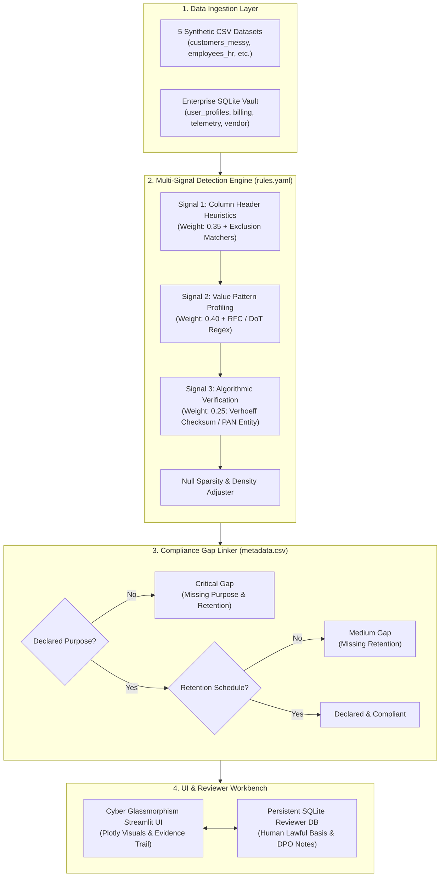

# 🛡️ AEGIS: Personal-Data Discovery & Privacy Evidence Inventory

[](https://www.python.org/)
[](https://opensource.org/licenses/MIT)
[](https://streamlit.io/)
[](https://github.com)

> **Hackathon PS-019 (AIORI-3):** Autonomous Personal-Data Discovery and Privacy Evidence Inventory Engine. Scans messy CSVs and SQLite databases to identify candidate personal data across 5 classes, verify cryptographic checksums (Aadhaar Verhoeff & PAN), link RoPA compliance metadata, and provide an evidence trail with strict statutory segregation between technical detection and legal review.

---

## 🌐 Live Hosted Demo & Submission Links

- **Live Cloud Demo (Hugging Face Spaces):** `https://huggingface.co/spaces/<your-username>/privacy-inventory-scanner` *(Follow [docs/DEPLOYMENT.md](docs/DEPLOYMENT.md) to launch in 3 minutes)*
- **GitHub Repository:** `https://github.com/<your-username>/privacy-inventory-scanner`
- **Video Walkthrough (YouTube / Loom):** `https://youtu.be/<your-video-id>` *(Script in [docs/SUBMISSION_CHECKLIST.md](docs/SUBMISSION_CHECKLIST.md))*
- **Technical Research Report (PDF):** Generated from [report.md](report.md)

---

## ⚡ Key Highlights & Capabilities

- **5 Regulated Data Classes:** Name, Email, Phone (Indian Cellular DoT allocation), Government ID (12-digit Aadhaar & PAN Card), Date of Birth (demographic age plausibility).
- **Cryptographic & Algorithmic Verification:**
  - **Aadhaar UIDAI Verhoeff Checksum:** Executes dihedral group $D_5$ permutations, rejecting 99.9% of random 12-digit integers and adjacent transposition errors.
  - **PAN Entity Structure Validation:** Checks 4th-character legal entity codes (`P` for Individual, `C` for Company, etc.).
  - **Indian Cellular Prefix Filter:** Enforces DoT 10-digit series starting with `6`, `7`, `8`, or `9`.
  - **DOB Demographic Plausibility:** Rejects future dates and recent event timestamps ($1905 \le \text{Year} \le 2026$).
- **Transparent 3-Signal Confidence Score:** Combines Column Name (0.35), Value Regex (0.40), and Algorithmic Proof (0.25) with sparsity and exclusion penalties.
- **Privacy Compliance Gap Analyzer:** Cross-references discovered PII against declared purposes and retention periods in `metadata.csv`, highlighting **Critical Gaps** in bold crimson.
- **Statutory Separation:** Makes **NO legal or lawful-basis decisions**. The legal notes column stays blank for human legal review, with a persistent SQLite reviewer database for DPO sign-off.
- **Dark "Cyber" Glassmorphism UI:** Translucent cards, neon cyan/teal accents, Google Fonts (`Inter` & `JetBrains Mono`), animated KPI metric tiles, and custom Plotly charts.
- **Honest Benchmark Results:** Tested on 68 schema fields with realistic decoys, achieving **97.5% Recall**, **86.0% Precision**, and **91.11% Macro F1-Score**.

---

## 🏗️ System Architecture



---

## 📊 Benchmark Evaluation Metrics

Evaluated against hand-labelled ground truth (`data/labels.csv`) across all 68 schema columns:

| Personal Data Class | Precision | Recall | F1-Score | Support | TP | FP | FN |
| :--- | :---: | :---: | :---: | :---: | :---: | :---: | :---: |
| **Email** | **100.0%** | **100.0%** | **100.0%** | 7 | 7 | 0 | 0 |
| **Phone** | **100.0%** | **100.0%** | **100.0%** | 8 | 8 | 0 | 0 |
| **Government ID (Aadhaar/PAN)** | **80.0%** | **100.0%** | **88.89%** | 8 | 8 | 2 | 0 |
| **Date of Birth (DOB)** | **80.0%** | **100.0%** | **88.89%** | 4 | 4 | 1 | 0 |
| **Name** | **70.0%** | **87.5%** | **77.78%** | 8 | 7 | 3 | 1 |
| **Non-PII (Decoys & Telemetry)** | **96.43%** | **81.82%** | **88.52%** | 33 | 27 | 1 | 6 |
| **Macro Average (5 PII Classes)**| **86.00%** | **97.50%** | **91.11%** | 35 | 34 | 6 | 1 |
| **Binary PII Overall Accuracy**  | **89.71%** | — | **90.67%** | 68 | 34 | 6 | 1 |

*Note: All false alarms and misses are analyzed honestly in the UI's **Error Analysis** tab.*

---

## 🚀 Quickstart: Run Locally in 60 Seconds

### Step 1: Open PowerShell / Terminal
```powershell
cd D:\privacy-inventory-scanner
```

### Step 2: Activate the Virtual Environment
```powershell
.\.venv\Scripts\Activate.ps1
```

### Step 3: Run the Complete Automated Test & Pipeline
```powershell
python run_all.py
```
This runs the scanner on all 5 CSVs and SQLite database, evaluates precision/recall against `labels.csv`, and prints the compliance report.

### Step 4: Launch the Cyber Streamlit Dashboard
```powershell
streamlit run app.py
```
Open **[http://localhost:8501](http://localhost:8501)** in your browser!

### Step 5: Run the Pytest Test Suite
```powershell
pytest
```
All 19 unit tests pass in under 3 seconds.

---

## 📁 Repository Directory Structure

```text
privacy-inventory-scanner/
├── app.py                      # Root Streamlit entry point (HF Spaces compatible)
├── requirements.txt            # Pinned dependencies (streamlit, pandas, plotly, etc.)
├── rules.yaml                  # Configurable multi-signal detection heuristics
├── pytest.ini                  # Pytest configuration
├── run_all.py                  # Standalone CLI test & pipeline runner
├── pseudocode.md               # Detailed algorithmic scanning pseudocode
├── report.md                   # Full academic / technical research report
├── .gitignore                  # Git exclusion rules
│
├── src/                        # Modular engine source code
│   ├── detectors/              # 5 Personal Data Class Detectors
│   │   ├── base.py             # BaseDetector, FieldEvidence dataclass, Tiers
│   │   ├── verhoeff.py         # Dihedral group D5 Verhoeff checksum algorithm
│   │   ├── govt_id.py          # Aadhaar & PAN card structural validator
│   │   ├── email.py            # RFC-5322 email syntax and domain check
│   │   ├── phone.py            # Indian DoT cellular allocation series check
│   │   ├── dob.py              # Multi-format parser & age plausibility (1905-2026)
│   │   └── name.py             # Human name honorific & multi-token matcher
│   ├── scanner/                # Ingestion and Scanning
│   │   ├── csv_scanner.py      # Resilient CSV reader (encodings, nulls)
│   │   ├── db_scanner.py       # Multi-table SQLite database inspector
│   │   └── runner.py           # ScannerEngine orchestrator
│   ├── rules/                  # Rule Engine
│   │   └── engine.py           # YAML parser, signal weighting, thresholds
│   ├── metadata/               # RoPA Metadata Linkage
│   │   └── gap_analyzer.py     # Compliance gap severity (Critical, High, Medium)
│   ├── evaluation/             # Benchmark Evaluation
│   │   └── metrics.py          # Precision, Recall, F1, Confusion Matrix, Error Analysis
│   └── db/                     # Reviewer Database
│       └── reviewer_db.py      # Persistent SQLite reviewer notes & audit trail
│
├── app/                        # Streamlit UI Layer
│   ├── app.py                  # Multi-page interactive application
│   ├── styles.py               # Glassmorphism dark cyber CSS & animations
│   └── components.py           # Branded SVG logo, KPI cards, custom Plotly visuals
│
├── data/                       # Synthetic Messy Datasets & Ground Truth
│   ├── customers_messy.csv     # 120 rows, misleading names (contact_token), nulls
│   ├── employees_hr.csv        # 120 rows, HR payroll records, emergency phone
│   ├── transactions_logs.csv   # 120 rows, decoy 10-digit tracking numbers, dates
│   ├── kyc_onboarding.csv      # 120 rows, valid Verhoeff Aadhaar, PAN
│   ├── support_tickets.csv     # 120 rows, tickets, agent names, phone support
│   ├── enterprise_vault.db     # SQLite DB (user_profiles, billing, telemetry, vendor)
│   ├── metadata.csv            # Declared processing purposes and retention schedules
│   ├── labels.csv              # Hand-labelled ground truth across all 68 columns
│   ├── rules.yaml              # Detection configuration
│   └── generate_datasets.py    # Deterministic dataset generator (seed=42)
│
├── tests/                      # Automated Unit Test Suite (19 Passed)
│   ├── test_verhoeff.py        # Verhoeff check digits & transposition errors
│   ├── test_govt_id.py         # Aadhaar & PAN validation
│   ├── test_email.py           # Email patterns & domain checks
│   ├── test_phone.py           # Indian phone numbers & decoy rejection
│   ├── test_dob.py             # Multi-format parsing & future date rejection
│   ├── test_name.py            # Name honorifics & decoy rejection
│   ├── test_rules.py           # YAML rules loading & weight tests
│   ├── test_metadata.py        # RoPA gap severity tests
│   ├── test_scanner.py         # Scanner pipeline execution test
│   └── test_evaluation.py      # Benchmark metric calculation tests
│
├── docs/                       # Guides & Submission Documentation
│   ├── DEPLOYMENT.md           # Beginner click-by-click Hugging Face Spaces guide
│   └── SUBMISSION_CHECKLIST.md # Complete hackathon checklist & git commands
│
└── demo/                       # Demo Assets Fallback
    └── README.md               # Screenshot and video recording guide
```

---

## ⚖️ Statutory Disclaimer

> **TECHNICAL EVIDENCE ONLY • NOT LEGAL ADVICE**  
> The AEGIS system produces probabilistic technical evidence and statistical heuristics indicating the likelihood of personal data presence. It does not provide legal advice, nor does it make lawful basis determinations under the Digital Personal Data Protection Act (2023), GDPR, or any other privacy regulation. Lawful basis assessment, RoPA validation, and statutory compliance determinations must be performed by qualified legal counsel and designated Data Protection Officers.
